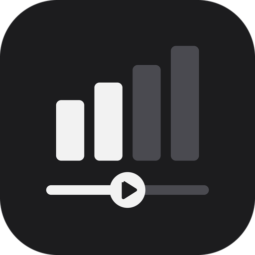
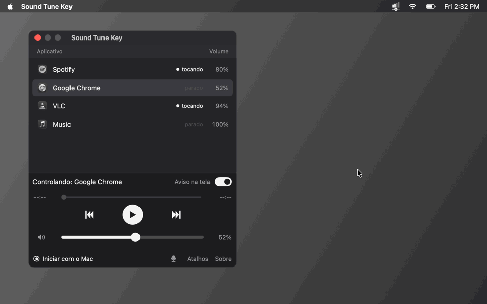

#  Sound Tune Key

🇺🇸 **English** | 🇧🇷 [Português](README.pt-BR.md)

Control the audio of **one specific app** straight from your keyboard.

Pick the app you want to control — Spotify, Google Chrome, Discord or anything else that is playing sound — and use global hotkeys to change its volume, pause it or skip tracks. The rest of your computer's volume stays untouched.

[▶ Watch in higher quality (MP4)](docs/demo/demo-en.mp4)

 

---

## 💻 Requirements

### Windows

- Windows 10 or 11
- Nothing to install: it is a single `.exe`.

### macOS

- macOS 14.2 or later, on Apple chip or Intel Macs
- Nothing to install: unzip and open.

---

## ⌨️ Hotkeys

### Windows

| Hotkey | Action |
|---|---|
| `Ctrl + Alt + ↑` | 🔊 Volume up for the selected app |
| `Ctrl + Alt + ↓` | 🔉 Volume down for the selected app |
| `Ctrl + Alt + P` | ⏯️ Play / pause |
| `Ctrl + Alt + →` | ⏭️ Next track |
| `Ctrl + Alt + ←` | ⏪ Restart the current track · press twice within 1 s for ⏮️ previous track |
| `Ctrl + Alt + M` | 🔇 Mute / unmute the selected app (its volume is kept) |
| `Ctrl + Alt + A` | 🔁 Switch the controlled app to the next one in the list (shown in the on-screen notice) |
| `Ctrl + Alt + V` | 🎤 Mute / unmute the microphone (the whole Windows mic, for Discord, games and everything) |

When you use the volume or mute hotkeys, a small notice shows the app and the volume at the bottom of the screen (when muted, the app name and the speaker turn red) for a moment, without taking the focus from your game. It does not appear over games in exclusive full screen (borderless window works). To turn it off, switch off **Aviso na tela** (On-screen notice) next to "Controlando" in the window, or **Mostrar aviso na tela** in the tray menu.

> ℹ️ Play/pause and track skipping depend on the app exposing media controls to Windows (Spotify and Chrome tabs do). Apps without that support, such as Discord, can only have their volume controlled.

The hotkeys are also listed inside the app: click **Atalhos** (Hotkeys) at the bottom of the window, or the **Atalhos** item of the tray icon, to open a small window with the list. **Sobre** (About), next to it, shows the version, the author and the GitHub link.

### macOS

| Hotkey | Action |
|---|---|
| `⌘ + ⌥ + ↑` | 🔊 Volume up for the selected app (hold to repeat) |
| `⌘ + ⌥ + ↓` | 🔉 Volume down for the selected app (hold to repeat) |
| `⌃ + ⌥ + M` | 🔇 Mute / unmute the selected app (the volume is kept) |
| `⌃ + ⌥ + P` | ⏯️ Play / pause |
| `⌃ + ⌥ + →` | ⏭️ Next track |
| `⌃ + ⌥ + ←` | ⏪ Restart the current track · press twice within 1 s for ⏮️ previous track |
| `⌃ + ⌥ + A` | 🔁 Switch the controlled app to the next one in the list (shown in the on-screen notice) |
| `⌃ + ⌥ + V` | 🎤 Mute / unmute the microphone (the whole Mac's: works for Discord, games and everything) |

When you use the volume, mute, switch-app or microphone hotkeys, a small notice shows the app and the volume at the bottom of the screen (red when muted) for a moment, without taking the focus, even over full-screen games. To turn it off, switch off **Aviso na tela** (On-screen notice), next to "Controlando" in the window, or **Mostrar aviso na tela** in the menu bar menu.

> ℹ️ `⌃` is Control and `⌥` is Option. The media hotkeys control the selected app when it is **Spotify**, **Music**, **VLC** or a video in **Google Chrome**; the Mac's own media keys (F7/F8/F9) keep working for whatever app is playing. The hotkeys are also listed inside the app: click **Atalhos** (Shortcuts) at the bottom of the window. Next to it, **Sobre** (About) shows the version, the author and the GitHub link, and the 🎤 icon mutes and unmutes the microphone.

---

## 🚀 How to use

### Windows

1. Click **Windows · Download .exe** above.
2. Open the program.
3. Select the app you want to control from the list.
4. Done! Use the hotkeys above, even while in-game.

The program remembers the last app you picked the next time it opens. Apps that are playing show a speaker next to the volume. Open apps that haven't played sound yet show in gray at the end of the list: you can pick one ahead of time, and volume control starts once it plays (Windows only gives an app its own volume after that).

Under "Controlando" (Controlling), the window has the track **time bar** (current time on the left, length on the right; drag to jump to another part of the song or video), the **⏮ ⏯ ⏭** buttons, which do the same as the hotkeys, and the 🔈 volume bar. Click the 🔈 speaker to mute or unmute (muted: red speaker, dimmed bar, app name in red in the list); changing the volume also unmutes. The hotkeys change the volume 1% at a time (hold to repeat). Right-click any app in the list for **Mudo** (Mute), checked while that app is muted; it does not change the controlled app. The time bar only works with apps that report the track time to Windows (Spotify and Chrome tabs do).

#### ⚠️ Windows warning on first run

The `.exe` is not digitally signed yet, so Windows may show **"Windows protected your PC"**. To open it, click **More info** → **Run anyway**. You only need to do this once.

If Windows blocks it **with no "Run anyway" button**, the PC has **Smart App Control** turned on. It blocks every program without a paid digital signature, and there is no way to allow just one program. The only way to open Sound Tune Key there is to turn it off in **Windows Security → App & browser control → Smart App Control settings → Off**. Windows does not let you turn it back on without reinstalling the system, so decide carefully. Most PCs already have it off.

#### 🖥️ System tray

Closing or minimizing the window does not quit the program: it stays in the tray icon (next to the clock) and the hotkeys keep working. The program is in Portuguese; right-click the icon for:

- **Sound Tune Key**, at the very top with the app icon — opens **Sobre** (About): version, author, the GitHub link and a button to check for updates
- Below it, like Spotify: the **time bar**, the **⏮ ⏯ ⏭** buttons and the **volume** of the selected app; the menu stays open so you can click more than once
- **Microfone ligado / desligado** (Microphone on / off) — turn the microphone on or off; red when it is off
- **Abrir** (Open) — show the window again
- **Aplicativos** (Apps) — click an app to control it; its submenu has **Mudo** (Mute), and muted apps show in red. The list updates by itself (every 5 seconds while open). Picking and toggling don't close the menu, so you can fix a wrong pick right away
- **Atalhos** (Hotkeys) — open the small window with the hotkey list
- **Iniciar com o Windows** (Start with Windows) — start the program automatically, already in the tray, when the PC boots
- **Mostrar aviso na tela** (Show on-screen notice) — turn the volume/mute notice on or off
- **Verificar atualizações...** (Check for updates...) — says whether there is a newer version; **Atualizar agora** (Update now) downloads it, swaps the program and reopens it by itself. The app also checks once a day: when there is a new version it shows a Windows notification, an **Atualizar para a versão…** item at the top of this menu and a strip at the bottom of the window
- **Sair** (Quit) — quit the program

### macOS

1. Click **macOS · Download .zip** above and open the `.zip` to unzip it.
2. Move `SoundTuneKey.app` to the **Applications** folder and open it.
3. Select the app you want to control from the list.
4. The first time you change a volume, macOS asks for **System Audio Recording** permission: allow it. That is how Sound Tune Key changes the volume of one app only.

The program remembers the last app you picked and the volume of each app. The volume only applies while Sound Tune Key is open: when you quit it, every app goes back to its normal volume until you open it again.

The **Iniciar com o Mac** (Start with Mac) dot at the bottom of the window opens the program automatically, already in the menu bar, when you log in. Move the app to **Applications** before turning it on.

Under "Controlando" (Controlling), the window has the track **time bar** (current time on the left, length on the right; drag to jump to another part), the **⏮ ⏯ ⏭** buttons and the 🔈 volume bar. Click the speaker (or right-click the app in the list) to mute it: the name and the speaker turn red, and changing the volume unmutes. ⏮ restarts the current track; press it twice within 1 s for the previous track. The buttons and the time bar work with **Spotify**, **Music**, **VLC** and videos in **Google Chrome**: the first time, macOS asks whether Sound Tune Key may control them, just allow it. With other apps they are greyed out.

> ℹ️ **Chrome:** turn on, once in each Chrome profile, **Ver → Desenvolvedor → Permitir o JavaScript do Eventos da Apple** (View → Developer → Allow JavaScript from Apple Events) in the Mac menu bar while Chrome is in front. Until then, Sound Tune Key shows a warning with a **Como ligar** (How to turn it on) button that lists the steps and brings Chrome to the front. Chrome's volume works without it. In Chrome, ⏭ and the double ⏮ switch videos on YouTube.

#### ⚠️ macOS warning on first run

The app is not notarized by Apple, so the first time macOS says it **could not verify that the app is free of malware**. To open it:

1. Move `SoundTuneKey.app` to the **Applications** folder first (so you don't have to allow it again after moving it).
2. Open the app. In the warning, click **OK** / **Done** — **not** "Move to Trash".
3. Go to **System Settings → Privacy & Security** and scroll down to **Security**.
4. Next to the message about "SoundTuneKey", click **Open Anyway** and confirm with your password or Touch ID.

The **Open Anyway** button only shows up right after you try to open the app: if it is not there, open the app again and go back to Settings. You only need to do this once.

#### 🖥️ Menu bar

Closing the window does not quit the program: it stays in the menu bar icon (next to Wi-Fi) and the hotkeys keep working. To move the icon, hold **⌘** and drag it. The program is in Portuguese; click the icon for:

- At the top, like Spotify: the **time bar**, the **⏮ ⏯ ⏭** buttons and the **volume** of the selected app; the menu stays open so you can click more than once
- **Sound Tune Key** (at the top) — opens **Sobre** (About); when there is a new version, **Atualizar para a versão X** (Update to version X) shows up
- **Microfone ligado / desligado** (Microphone on / off) — mutes and unmutes the microphone (red when off)
- **Abrir** (Open) — show the window again
- **Aplicativos** (Apps) — click an app to control it (the checked app is the one being controlled); its submenu has **Mudo** (Mute). Picking and toggling don't close the menu, so you can fix a wrong pick right away; muted apps show in red, and the menu bar icon turns red while the chosen app is muted
- **Atalhos** (Hotkeys) — open the small window with the hotkey list
- **Iniciar com o Mac** (Start with Mac) — start the program automatically, already in the menu bar, when you log in
- **Mostrar aviso na tela** (Show on-screen notice) — turns the volume and mute notice on or off
- **Verificar atualizações...** (Check for updates) — looks for a new version; **Atualizar agora** (Update now) downloads it, replaces the app and opens it again
- **Sair** (Quit) — quit the program

The program also checks for a new version by itself (at start and once a day) and tells you with a notification, the menu item and a strip in the window.

To build it from source instead, run `mac/build-app.sh` (needs the Xcode Command Line Tools: `xcode-select --install`).

---

## 🛠️ Built with

### Windows

- **C# / .NET** — native Windows app
- **Windows Core Audio (WASAPI)** — per-app volume control
- **Windows Media Controls (SMTC)** — play/pause, next, previous and the track time bar
- **Win32 `RegisterHotKey`** — global keyboard hotkeys

### macOS

- **Swift / SwiftUI** — native Mac app
- **Core Audio process taps** — per-app volume control
- **AppleScript** — play/pause, next, previous and the time bar for Spotify, Music and VLC, and for Chrome videos through JavaScript
- **Carbon `RegisterEventHotKey`** — global keyboard hotkeys
