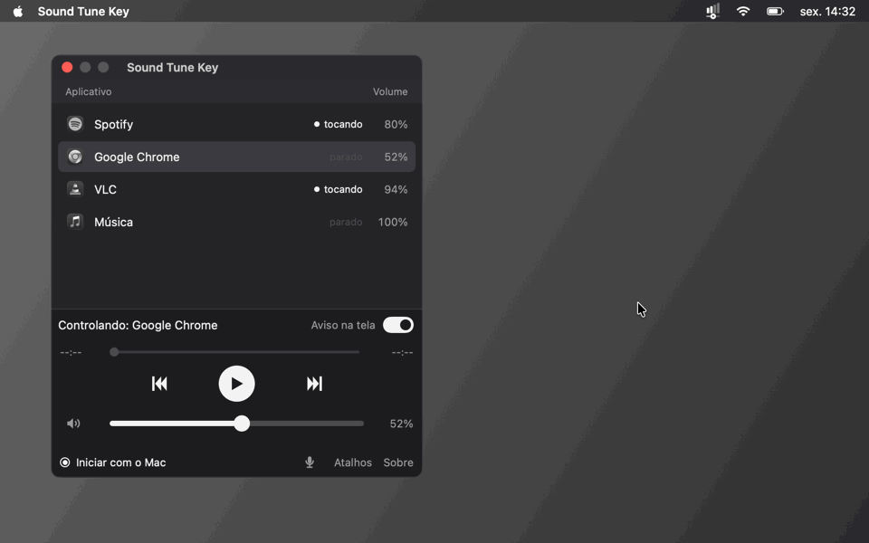

#  Sound Tune Key

🇺🇸 [English](README.md) | 🇧🇷 **Português**

Controle o áudio de **um aplicativo específico** direto pelo teclado.

Escolha o app que você quer controlar — Spotify, Google Chrome, Discord ou qualquer outro que esteja tocando som — e use atalhos globais para ajustar o volume, pausar ou trocar de música. O volume do resto do computador não é alterado.

[▶ Assistir em qualidade melhor (MP4)](docs/demo/demo-pt.mp4)

 

---

## 💻 Requisitos

### Windows

- Windows 10 ou 11
- Não precisa instalar nada: é um único `.exe`.

### macOS

- macOS 14.2 ou mais novo, em Macs com chip Apple ou Intel
- Não precisa instalar nada: é só descompactar e abrir.

---

## ⌨️ Atalhos

### Windows

| Atalho | Função |
|---|---|
| `Ctrl + Alt + ↑` | 🔊 Aumenta o volume do app selecionado |
| `Ctrl + Alt + ↓` | 🔉 Diminui o volume do app selecionado |
| `Ctrl + Alt + P` | ⏯️ Pausar / continuar |
| `Ctrl + Alt + →` | ⏭️ Próxima música |
| `Ctrl + Alt + ←` | ⏪ Volta ao começo da música · aperte duas vezes em menos de 1 s para ⏮️ música anterior |
| `Ctrl + Alt + M` | 🔇 Deixa mudo / volta o som do app selecionado (o volume fica guardado) |
| `Ctrl + Alt + A` | 🔁 Troca o app controlado para o próximo da lista (aparece no aviso na tela) |
| `Ctrl + Alt + V` | 🎤 Desliga / liga o microfone (o do Windows inteiro: vale para Discord, jogo e tudo) |

Ao usar os atalhos de volume ou de mudo, um aviso pequeno mostra o app e o volume embaixo da tela (no mudo, o nome do app e o alto-falante ficam vermelhos) por um instante, sem tirar o foco do jogo. Ele não aparece por cima de jogos em tela cheia exclusiva (em janela sem borda funciona). Para desligar, desligue o interruptor **Aviso na tela**, ao lado de "Controlando" na janela, ou **Mostrar aviso na tela** no menu da bandeja.

> ℹ️ Pausar e trocar de música dependem de o app expor controles de mídia ao Windows (Spotify e abas do Chrome expõem). Apps sem esse suporte, como o Discord, podem ser controlados apenas no volume.

Os atalhos também aparecem dentro do programa: clique em **Atalhos**, embaixo da janela, ou no item **Atalhos** do ícone da bandeja, e abre uma janelinha com a lista. Ao lado, **Sobre** mostra a versão, o autor e o link do GitHub.

### macOS

| Atalho | Função |
|---|---|
| `⌘ + ⌥ + ↑` | 🔊 Aumenta o volume do app selecionado (segurar repete) |
| `⌘ + ⌥ + ↓` | 🔉 Diminui o volume do app selecionado (segurar repete) |
| `⌃ + ⌥ + M` | 🔇 Deixa mudo / volta o som do app selecionado (o volume fica guardado) |
| `⌃ + ⌥ + P` | ⏯️ Pausar / continuar |
| `⌃ + ⌥ + →` | ⏭️ Próxima música |
| `⌃ + ⌥ + ←` | ⏪ Volta ao começo da música · aperte duas vezes em menos de 1 s para ⏮️ música anterior |
| `⌃ + ⌥ + A` | 🔁 Troca o app controlado para o próximo da lista (aparece no aviso na tela) |
| `⌃ + ⌥ + V` | 🎤 Desliga / liga o microfone (o do Mac inteiro: vale para Discord, jogo e tudo) |

Ao usar os atalhos de volume, mudo, troca de app ou microfone, um aviso pequeno mostra o app e o volume embaixo da tela (no mudo, em vermelho) por um instante, sem tirar o foco, até sobre jogos em tela cheia. Para desligar, desligue o interruptor **Aviso na tela**, ao lado de "Controlando" na janela, ou **Mostrar aviso na tela** no menu da barra.

> ℹ️ `⌃` é a tecla Control e `⌥` é a Option. Os atalhos de mídia controlam o app escolhido quando ele é o **Spotify**, o **Música**, o **VLC** ou um vídeo no **Google Chrome**; as teclas de mídia do próprio Mac (F7/F8/F9) continuam valendo para o app que estiver tocando. Os atalhos também aparecem dentro do programa: clique em **Atalhos**, embaixo da janela. Ao lado, **Sobre** mostra a versão, o autor e o link do GitHub, e o ícone 🎤 liga e desliga o microfone.

---

## 🚀 Como usar

### Windows

1. Clique em **Windows · Baixar .exe** acima.
2. Abra o programa.
3. Selecione na lista o aplicativo que você quer controlar.
4. Pronto! Use os atalhos acima, inclusive dentro do jogo.

O programa lembra o último app escolhido da próxima vez que for aberto.

Embaixo de "Controlando", a janela tem a **barra de tempo** da música (tempo atual à esquerda, duração à direita; arraste para ir para outro trecho da música ou do vídeo), os botões **⏮ ⏯ ⏭**, que fazem o mesmo que os atalhos, e a barra de volume 🔈. Clique no alto-falante 🔈 para deixar mudo ou voltar o som (no mudo: alto-falante vermelho, barra apagada e o nome do app em vermelho na lista); mexer no volume também tira o mudo. Os atalhos mudam o volume de 1% em 1% (segurar repete). Com o botão direito em qualquer app da lista aparece **Mudo**, marcado quando aquele app está mudo; isso não troca o app controlado. A barra de tempo só funciona com apps que informam o tempo da música ao Windows (Spotify e abas do Chrome informam).

#### ⚠️ Aviso do Windows na primeira vez

O `.exe` ainda não tem assinatura digital, então o Windows pode mostrar **"O Windows protegeu o computador"**. Para abrir, clique em **Mais informações** → **Executar assim mesmo**. Isso só é preciso na primeira vez.

Se o Windows bloquear **sem o botão "Executar assim mesmo"**, o PC está com o **Controle Inteligente de Aplicativos** ligado. Ele bloqueia todo programa sem assinatura digital paga, e não dá para liberar só um programa. A única forma de abrir o Sound Tune Key nesse PC é desligá-lo em **Segurança do Windows → Controle de aplicativos e do navegador → Configurações do Controle Inteligente de Aplicativos → Desativado**. O Windows não deixa ligar de novo sem reinstalar o sistema, então pense bem antes. Na maioria dos PCs ele já vem desligado.

#### 🖥️ Bandeja do Windows

Fechar ou minimizar a janela não encerra o programa: ele continua no ícone da bandeja (perto do relógio) e os atalhos seguem funcionando. Clique com o botão direito no ícone para:

- **Sound Tune Key**, bem no topo com o ícone do app — abre o **Sobre**: versão, autor, o link do GitHub e um botão para verificar atualizações
- Logo abaixo, como no Spotify: a **barra de tempo**, os botões **⏮ ⏯ ⏭** e o **volume** do app escolhido; o menu fica aberto para clicar mais de uma vez
- **Microfone ligado / desligado** — liga ou desliga o microfone; fica vermelho quando está desligado
- **Abrir** — mostra a janela de novo
- **Aplicativos** — clique num app para controlá-lo; o submenu dele tem **Mudo**, e apps mudos aparecem em vermelho. A lista se atualiza sozinha (a cada 5 segundos, enquanto está aberta). Escolher e ligar/desligar não fecham o menu, para corrigir na hora
- **Atalhos** — abre a janelinha com a lista de atalhos
- **Iniciar com o Windows** — abre o programa sozinho, já na bandeja, quando o PC liga
- **Mostrar aviso na tela** — liga ou desliga o aviso de volume e mudo
- **Verificar atualizações...** — diz se tem versão nova; **Atualizar agora** baixa, troca o programa e reabre sozinho. O app também procura uma vez por dia: com versão nova, mostra uma notificação do Windows, o item **Atualizar para a versão…** no topo deste menu e uma faixa embaixo da janela
- **Sair** — encerra o programa

### macOS

1. Clique em **macOS · Baixar .zip** acima e abra o `.zip` para descompactar.
2. Mova o `SoundTuneKey.app` para a pasta **Aplicativos** e abra.
3. Selecione na lista o aplicativo que você quer controlar.
4. Na primeira vez que você mudar um volume, o macOS pede a permissão de **Gravação de áudio do sistema**: aceite. É assim que o Sound Tune Key muda o volume de um app só.

O programa lembra o último app escolhido e o volume de cada app. O volume vale enquanto o Sound Tune Key estiver aberto: ao fechá-lo, os apps voltam ao volume normal até você abrir de novo.

A bolinha **Iniciar com o Mac**, embaixo da janela, abre o programa sozinho, já na barra de menus, quando você entra no Mac. Mova o app para **Aplicativos** antes de ligar.

Embaixo de "Controlando", a janela tem a **barra de tempo** da música (tempo atual à esquerda, duração à direita; arraste para ir para outro trecho), os botões **⏮ ⏯ ⏭** e a barra de volume 🔈. Clique no alto-falante (ou no app com o botão direito, na lista) para deixar o app mudo: o nome e o alto-falante ficam vermelhos, e mexer no volume tira o mudo. O ⏮ volta ao começo da música; dois toques em menos de 1 s vão para a música anterior. Os botões e a barra de tempo funcionam com o **Spotify**, o **Música**, o **VLC** e vídeos no **Google Chrome**: na primeira vez, o macOS pergunta se o Sound Tune Key pode controlá-los, e é só aceitar. Com outros apps, eles ficam apagados.

> ℹ️ **Chrome:** ligue uma vez, em cada perfil do Chrome, **Ver → Desenvolvedor → Permitir o JavaScript do Eventos da Apple** na barra de menus do Mac, com o Chrome na frente. Enquanto não estiver ligado, o Sound Tune Key mostra um aviso com o botão **Como ligar**, que mostra os passos e traz o Chrome para a frente. O volume do Chrome funciona mesmo sem isso. No Chrome, o ⏭ e o ⏮ duplo trocam de vídeo no YouTube.

#### ⚠️ Aviso do macOS na primeira vez

O app não é autenticado pela Apple, então na primeira vez o macOS diz que **não pôde verificar se o app está livre de malware**. Para abrir:

1. Mova o `SoundTuneKey.app` para a pasta **Aplicativos** antes (assim não precisa liberar de novo depois de mover).
2. Abra o app. No aviso, clique em **OK** / **Concluído** — **não** clique em "Mover para o Lixo".
3. Vá em **Ajustes do Sistema → Privacidade e Segurança** e role até a parte **Segurança**.
4. Na mensagem sobre o "SoundTuneKey", clique em **Abrir Mesmo Assim** e confirme com a sua senha ou o Touch ID.

O botão **Abrir Mesmo Assim** só aparece logo depois de você tentar abrir o app: se não estiver lá, abra o app de novo e volte nos Ajustes. Isso só é preciso na primeira vez.

#### 🖥️ Barra de menus

Fechar a janela não encerra o programa: ele continua no ícone da barra de menus (perto do Wi-Fi) e os atalhos seguem funcionando. Para mudar o ícone de lugar, segure **⌘** e arraste. Clique no ícone para:

- No topo, como no Spotify: a **barra de tempo**, os botões **⏮ ⏯ ⏭** e o **volume** do app escolhido; o menu fica aberto para clicar mais de uma vez
- **Sound Tune Key** (no topo) — abre o **Sobre**; quando há versão nova, aparece **Atualizar para a versão X**
- **Microfone ligado / desligado** — liga e desliga o microfone (vermelho quando desligado)
- **Abrir** — mostra a janela de novo
- **Aplicativos** — clique num app para controlá-lo (o marcado é o controlado); o submenu dele tem **Mudo**. Escolher e ligar/desligar não fecham o menu, para corrigir na hora; apps mudos aparecem em vermelho, e o ícone da barra fica vermelho quando o app escolhido está mudo
- **Atalhos** — abre a janelinha com a lista de atalhos
- **Iniciar com o Mac** — abre o programa sozinho, já na barra de menus, quando você entra no Mac
- **Mostrar aviso na tela** — liga ou desliga o aviso de volume e mudo
- **Verificar atualizações...** — procura uma versão nova; **Atualizar agora** baixa, troca o app e abre de novo
- **Sair** — encerra o programa

O programa também procura versão nova sozinho (ao abrir e uma vez por dia) e avisa com uma notificação, o item no menu e uma faixa na janela.

Para compilar a partir do código, rode `mac/build-app.sh` (precisa das ferramentas de linha de comando do Xcode: `xcode-select --install`).

---

## 🛠️ Tecnologias

### Windows

- **C# / .NET** — aplicativo nativo para Windows
- **Windows Core Audio (WASAPI)** — controle de volume por aplicativo
- **Windows Media Controls (SMTC)** — pausar, próxima, anterior e a barra de tempo da música
- **Win32 `RegisterHotKey`** — atalhos globais de teclado

### macOS

- **Swift / SwiftUI** — aplicativo nativo para Mac
- **Core Audio process taps** — controle de volume por aplicativo
- **AppleScript** — pausar, próxima, anterior e a barra de tempo no Spotify, no Música e no VLC, e nos vídeos do Chrome por JavaScript
- **Carbon `RegisterEventHotKey`** — atalhos globais de teclado
